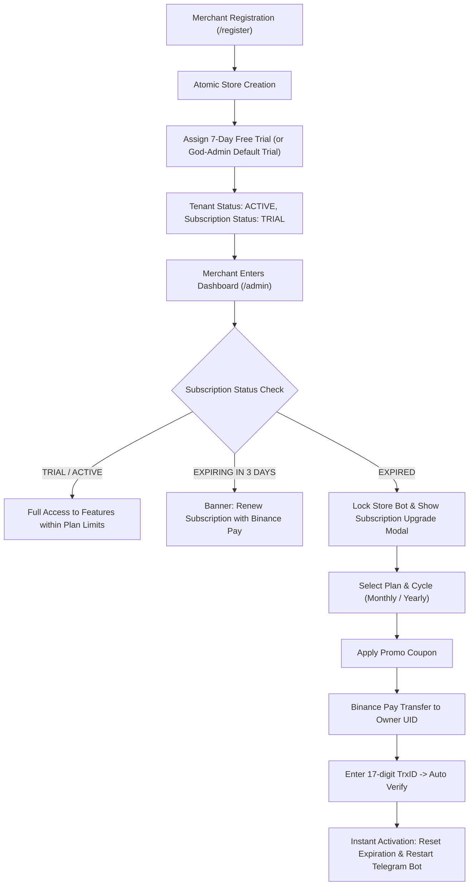

# Implementation Plan: Subscription, Plans, Coupons & Binance Pay Engine

## 1. Executive Summary & Problem Diagnosis
Currently:
1. **Subscription Status**: Hardcoded to `plan_id = 'starter'` in database with zero billing cycle, expiration date, or renewal mechanism.
2. **Account Creation / Onboarding**: Merchants register without understanding their subscription tier, trial length, or how to upgrade.
3. **No Pricing Flexibility**: Plans are hardcoded in `shared/constants.ts`; God-Admin cannot change prices, features, or plan limits.
4. **No Coupon System**: No ability to create promotional codes (`LAUNCH50`, `EID2026`) for discounts.
5. **No Subscription Payment Flow**: No automated Binance Pay checkout for merchants to purchase or renew subscriptions directly to the Platform Owner.

This plan outlines the complete end-to-end architecture to deliver a dynamic, automated subscription management engine.

---

## 2. Database Schema Design (SQLite WAL)

### 2.1 Table: `subscription_plans`
Stores God-Admin configured subscription packages.
```sql
CREATE TABLE IF NOT EXISTS subscription_plans (
    id TEXT PRIMARY KEY,                       -- e.g. 'starter', 'pro', 'enterprise'
    name TEXT NOT NULL,                        -- e.g. 'Starter Cloud', 'Pro Merchant'
    description TEXT,
    price_monthly_usd NUMERIC NOT NULL,        -- e.g. 8.00
    price_yearly_usd NUMERIC NOT NULL,         -- e.g. 80.00 (saves 2 months)
    max_products INTEGER DEFAULT 50,           -- -1 for unlimited
    allow_wholesale INTEGER DEFAULT 1,         -- 1 = yes, 0 = no
    allow_binance_pay INTEGER DEFAULT 1,       -- 1 = merchant can use binance auto-pay
    allow_custom_branding INTEGER DEFAULT 0,   -- 1 = white-label custom domain/branding
    features_json TEXT DEFAULT '[]',           -- JSON array of bullet strings
    is_popular INTEGER DEFAULT 0,              -- 1 = "Most Popular" badge
    is_active INTEGER DEFAULT 1,               -- 1 = available for purchase
    sort_order INTEGER DEFAULT 0,
    created_at TIMESTAMP DEFAULT CURRENT_TIMESTAMP,
    updated_at TIMESTAMP DEFAULT CURRENT_TIMESTAMP
);
```

### 2.2 Table: `coupons`
Discount codes created by God-Admin.
```sql
CREATE TABLE IF NOT EXISTS coupons (
    id INTEGER PRIMARY KEY AUTOINCREMENT,
    code TEXT UNIQUE NOT NULL,                 -- e.g. 'DISCOUNT50', 'EID2026' (uppercase)
    discount_type TEXT NOT NULL,               -- 'PERCENTAGE' or 'FIXED_USD'
    discount_value NUMERIC NOT NULL,           -- e.g. 20 (for 20%) or 5.00 ($5 off)
    applicable_plan_id TEXT DEFAULT 'ALL',     -- 'ALL' or specific plan ID
    applicable_cycle TEXT DEFAULT 'ALL',       -- 'ALL', 'MONTHLY', 'YEARLY'
    min_spend_usd NUMERIC DEFAULT 0.0,
    max_uses INTEGER DEFAULT -1,               -- -1 for unlimited
    used_count INTEGER DEFAULT 0,
    expires_at TIMESTAMP,                      -- Nullable: NULL = never expires
    is_active INTEGER DEFAULT 1,
    created_at TIMESTAMP DEFAULT CURRENT_TIMESTAMP
);
```

### 2.3 Table: `subscription_history`
Audit ledger of every subscription purchase, upgrade, or renewal.
```sql
CREATE TABLE IF NOT EXISTS subscription_history (
    id INTEGER PRIMARY KEY AUTOINCREMENT,
    tenant_id TEXT NOT NULL REFERENCES tenants(id) ON DELETE CASCADE,
    plan_id TEXT NOT NULL REFERENCES subscription_plans(id),
    billing_cycle TEXT NOT NULL,               -- 'MONTHLY' or 'YEARLY'
    original_price_usd NUMERIC NOT NULL,
    discount_amount_usd NUMERIC DEFAULT 0.0,
    final_amount_paid_usd NUMERIC NOT NULL,
    coupon_id INTEGER REFERENCES coupons(id),
    payment_method TEXT NOT NULL DEFAULT 'BINANCE_PAY',
    trx_id TEXT NOT NULL,
    period_start TIMESTAMP NOT NULL,
    period_end TIMESTAMP NOT NULL,
    created_at TIMESTAMP DEFAULT CURRENT_TIMESTAMP
);
```

### 2.4 Alterations to `tenants` Table
Add subscription lifecycle columns:
- `subscription_cycle`: `TEXT DEFAULT 'MONTHLY'` (`MONTHLY`, `YEARLY`, `TRIAL`)
- `subscription_status`: `TEXT DEFAULT 'TRIAL'` (`TRIAL`, `ACTIVE`, `GRACE`, `EXPIRED`, `SUSPENDED`)
- `subscription_started_at`: `TIMESTAMP DEFAULT CURRENT_TIMESTAMP`
- `subscription_expires_at`: `TIMESTAMP` (calculated expiration)
- `trial_ends_at`: `TIMESTAMP` (e.g. 7 days from registration)

---

## 3. Onboarding & Registration Lifecycle Flow



---

## 4. God-Admin Command Center Specifications (`/secure/hkjhl/sadmin`)

God-Admin will feature a dedicated **Plans & Coupons** tab with complete control:

### 4.1 Subscription Plans Management
1. **Plan List Cards**:
   - Card displays: Name, Monthly Price ($), Yearly Price ($), Product Limit, Wholesale Access toggle, Features list, Status toggle (`Active`/`Inactive`), Popular flag.
2. **Create / Edit Plan Modal**:
   - Plan Name (e.g. "Pro Store")
   - Monthly Price in USD (e.g. $19.99)
   - Yearly Price in USD (e.g. $199.99 — system auto-highlights "Save ~16%")
   - Product Limit (-1 for unlimited)
   - Wholesale Access checkbox
   - Binance Pay integration checkbox
   - Features List (dynamic tag/bullet adder: "+ Add feature line")
   - Is Popular toggle
3. **1-Click Delete / Deactivate Plan**:
   - Safe soft-disable so existing subscribed merchants are unaffected, but new merchants cannot pick it.

### 4.2 Coupon Management
1. **Coupon List Table**:
   - Columns: Code, Discount Type (% or Fixed $), Discount Value, Plan Restriction, Expiration Date, Usage (`used / max`), Active Toggle, Delete.
2. **Create Coupon Modal**:
   - Promo Code (auto-uppercase)
   - Discount Type: Percentage (e.g., 25%) or Fixed USD (e.g., $5.00)
   - Applicable Plan: "All Plans" or specific plan
   - Applicable Cycle: "All", "Monthly Only", "Yearly Only"
   - Max Redemptions (-1 for unlimited)
   - Expiration Date & Time picker

---

## 5. Merchant Dashboard Billing & Checkout (`/admin`)

### 5.1 Dedicated "Subscription" Tab
- **Current Plan Status Banner**:
  - Displays: Current Plan Name, Status badge (`Active` / `Trial` / `Expired`), Expiration Date.
  - Live Countdown: "⏳ 14 days 6 hours remaining".
  - Usage Meter: Products Used (e.g. 18 / 50 products).
- **Plan Comparison Grid**:
  - Toggle: **Monthly Billing** vs **Yearly Billing (Save up to 20%)**.
  - All active plans loaded dynamically from backend.
  - "Current Plan" indicator / "Upgrade" button.
- **Billing History Ledger**:
  - Complete history of past renewals, amounts paid, dates, and Binance Trx IDs.

### 5.2 Automated Binance Pay Subscription Modal
1. **Step 1: Plan & Cycle Selection**:
   - Selected Plan & Cycle displayed.
   - Base Price: `$XX.XX USD`.
2. **Step 2: Coupon Code Field**:
   - Input box: `Enter Coupon Code` -> Button: `Apply`.
   - Real-time validation endpoint: calculates discount and displays new price:
     - `Original: $80.00`
     - `Coupon (LAUNCH20): -$16.00`
     - `Final Payable: $64.00 USDT`
3. **Step 3: Binance Transfer Instructions**:
   - Shows **Platform Owner Binance Pay UID** (from God-Admin settings).
   - Dynamic QR code generation for Binance Pay.
   - Clear instructions: "Send exact $64.00 USDT to UID 1147094108".
4. **Step 4: Automated Verification**:
   - Input: 17-digit Transaction ID.
   - Button: `Verify & Activate Subscription Instant ⚡`.
   - Calls backend `/api/merchant/subscription/verify-binance`:
     - Checks Binance Trade History API using owner credentials.
     - Confirms amount and UID match.
     - Extends `subscription_expires_at` by 30 days (Monthly) or 365 days (Yearly).
     - Restarts merchant bot if stopped.
     - Returns instant success toast!

---

## 6. Landing Page (`/`) & Registration (`/register`) Dynamic Sync

1. **Landing Page (`client/src/pages/Landing.tsx`)**:
   - Replace static `PRICING_TIERS` with `useEffect` fetch to `GET /api/public/plans`.
   - Add **Billing Cycle Toggle Switch**:
     - `[ Monthly ]` / `[ Yearly (Save 20% 🎉) ]`
   - Dynamically render monthly vs yearly pricing based on toggle.
2. **Registration Page (`client/src/pages/Register.tsx`)**:
   - Provide visual clarity that signup starts with an Instant Free Trial.
   - Optional: Allow user to pre-select their desired plan on signup.

---

## 7. Telegram Bot Lifecycle & Subscription Gating

In `bot/src/registry.ts` and `bot/src/engine.ts`:
- Check tenant subscription status:
  - If `subscription_status === 'EXPIRED'`:
    - Bot sends polite message to customers if they try to browse/order:
      `⚠️ Store Maintenance: This shop is undergoing scheduled maintenance. Please check back shortly.`
    - Bot sends notification to store owner on Telegram:
      `🚨 Your Mogent Bot subscription has expired. Please visit your merchant dashboard to renew.`
- When renewed:
  - Bot automatically resumes normal high-speed operation.

---

## 8. Backend API Endpoints Implementation Map

| Endpoint | Method | Role | Description |
|---|---|---|---|
| `/api/public/plans` | GET | Public | Returns active subscription plans with monthly & yearly pricing |
| `/api/godmode/plans` | GET, POST, PUT, DELETE | Super Admin | Manage subscription plans (create, edit, toggle, delete) |
| `/api/godmode/coupons` | GET, POST, PUT, DELETE | Super Admin | Manage discount coupons (create, deactivate, delete) |
| `/api/merchant/subscription/current` | GET | Merchant | Returns merchant plan, cycle, expiry date, limits, and usage |
| `/api/merchant/subscription/validate-coupon` | POST | Merchant | Validates coupon code and calculates discounted payable amount |
| `/api/merchant/subscription/verify-binance` | POST | Merchant | Verifies Binance Pay TrxID and activates/renews subscription |
| `/api/merchant/subscription/history` | GET | Merchant | Returns past subscription payment invoices |

---

## 9. Verification & Quality Gates

1. **Plan CRUD Gate**:
   - Create Monthly + Yearly plan in God Admin -> Verify it appears instantly on Landing Page and Merchant Dashboard.
2. **Coupon Calculation Gate**:
   - Create 20% coupon -> Apply to $100 plan -> Verify payable is exactly $80.00.
   - Test expired coupon -> Verify proper error message.
   - Test max uses limit -> Verify coupon disables once limit reached.
3. **Binance SAPI Verification Gate**:
   - Verify transaction ID against Binance Pay trade history.
   - Prevent replay attacks using `crypto_verified_transactions`.
4. **Lifecycle & Expiry Gate**:
   - Test expired store -> Verify merchant warning and bot graceful suspension.
   - Test renewal -> Verify instant reactivation and bot restart without server restart.
